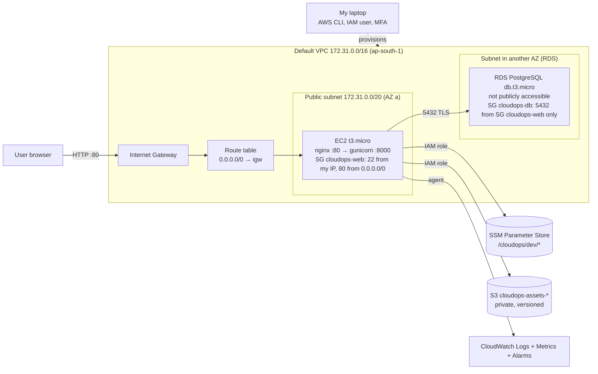

# Virtual networking on AWS — VPC, subnets, routing, security groups

Notes from module 03. Builds on [`02-networking/notes.md`](../../02-networking/notes.md) (CIDR,
subnetting, security groups vs NACLs).

## Architecture used by this module



Plain-text version:

```
 laptop (aws cli) ──provisions──▶ AWS account (ap-south-1)
                                   │
 browser ──:80──▶ Internet Gateway ─┤ default VPC 172.31.0.0/16
                                   │   route table: 172.31.0.0/16 local, 0.0.0.0/0 → igw
                                   │   ┌─ public subnet ─────────────────────────┐
                                   │   │ EC2 t3.micro  [SG web: 22 my-ip, 80 any] │
                                   │   │   nginx :80 → gunicorn 127.0.0.1:8000    │
                                   │   └──────────────┬───────────────────────────┘
                                   │                  │ :5432 (only from SG web)
                                   │   ┌──────────────▼───────────────────────────┐
                                   │   │ RDS PostgreSQL  [SG db]  no public IP    │
                                   │   └──────────────────────────────────────────┘
                                   │   EC2 role → SSM parameters, S3 bucket, CloudWatch
```

## Concepts

| Thing | What it is | In this module |
|---|---|---|
| **VPC** | Your own isolated network inside a region, with a CIDR block | the **default VPC** (`172.31.0.0/16`) — free, already has public subnets, so no NAT gateway cost (~$32/month) |
| **Subnet** | A slice of the VPC CIDR inside one Availability Zone | default subnets are `/20` per AZ, all public |
| **Route table** | Where traffic for each destination goes | `local` for the VPC range + `0.0.0.0/0 → igw` makes a subnet "public" |
| **Internet Gateway** | The VPC's door to the internet (1:1 NAT for public IPs) | attached to the default VPC |
| **NAT Gateway** | Lets *private* subnets reach the internet outbound only | **not used** (cost) — RDS needs no internet access |
| **Security group** | Stateful firewall on the ENI of an instance/RDS. Allow rules only | `cloudops-web`, `cloudops-db` (db allows 5432 *from the web SG*, not from an IP) |
| **NACL** | Stateless firewall on the subnet, allow + deny | left at default (allow all) |
| **Public IP / EIP** | Public IPv4 is auto-assigned in default subnets; an Elastic IP is static | auto-assigned (changes on stop/start). Unattached EIPs are charged |

Why SG-to-SG references matter: the DB rule says "from anything that carries `sg-web`", so if the
EC2 IP changes or you add a second web instance, the rule still holds and nothing else can reach
port 5432.

## Practical AWS CLI examples

Look around the default VPC (read-only):

```bash
aws ec2 describe-vpcs --query 'Vpcs[].{Id:VpcId,Cidr:CidrBlock,Default:IsDefault}' --output table
aws ec2 describe-subnets --filters Name=default-for-az,Values=true \
    --query 'Subnets[].{Id:SubnetId,AZ:AvailabilityZone,Cidr:CidrBlock,Public:MapPublicIpOnLaunch}' --output table
aws ec2 describe-route-tables --query 'RouteTables[].Routes[].{Dest:DestinationCidrBlock,Target:GatewayId}' --output table
aws ec2 describe-internet-gateways --query 'InternetGateways[].{Id:InternetGatewayId,Vpc:Attachments[0].VpcId}' --output table
aws ec2 describe-security-groups --filters Name=group-name,Values='cloudops-*' \
    --query 'SecurityGroups[].{Name:GroupName,Id:GroupId,In:IpPermissions}' --output json
```

Building a custom VPC by hand (**provisioning — creates resources**; nothing here costs money until
you add a NAT gateway or instances, but delete it afterwards):

```bash
VPC=$(aws ec2 create-vpc --cidr-block 10.0.0.0/16 --query Vpc.VpcId --output text \
        --tag-specifications 'ResourceType=vpc,Tags=[{Key=Name,Value=cloudops-lab}]')
aws ec2 modify-vpc-attribute --vpc-id "$VPC" --enable-dns-hostnames

PUB=$(aws ec2 create-subnet --vpc-id "$VPC" --cidr-block 10.0.1.0/24 --availability-zone ap-south-1a \
        --query Subnet.SubnetId --output text)
PRIV=$(aws ec2 create-subnet --vpc-id "$VPC" --cidr-block 10.0.2.0/24 --availability-zone ap-south-1b \
        --query Subnet.SubnetId --output text)
aws ec2 modify-subnet-attribute --subnet-id "$PUB" --map-public-ip-on-launch

IGW=$(aws ec2 create-internet-gateway --query InternetGateway.InternetGatewayId --output text)
aws ec2 attach-internet-gateway --vpc-id "$VPC" --internet-gateway-id "$IGW"

RT=$(aws ec2 create-route-table --vpc-id "$VPC" --query RouteTable.RouteTableId --output text)
aws ec2 create-route --route-table-id "$RT" --destination-cidr-block 0.0.0.0/0 --gateway-id "$IGW"
aws ec2 associate-route-table --route-table-id "$RT" --subnet-id "$PUB"   # PUB is now a public subnet
# PRIV keeps the main route table (local only) → private subnet, good for RDS.
```

Tear the lab VPC down (**destructive**, reverse order):

```bash
aws ec2 delete-route-table --route-table-id "$RT"      # after disassociating / deleting subnets
aws ec2 detach-internet-gateway --vpc-id "$VPC" --internet-gateway-id "$IGW"
aws ec2 delete-internet-gateway --internet-gateway-id "$IGW"
aws ec2 delete-subnet --subnet-id "$PUB"; aws ec2 delete-subnet --subnet-id "$PRIV"
aws ec2 delete-vpc --vpc-id "$VPC"
```

Security group rule management:

```bash
# tighten SSH to my current IP (home IP changed)
MYIP=$(curl -s https://checkip.amazonaws.com)
aws ec2 authorize-security-group-ingress --group-id sg-xxxx --protocol tcp --port 22 --cidr "$MYIP/32"
aws ec2 revoke-security-group-ingress    --group-id sg-xxxx --protocol tcp --port 22 --cidr 203.0.113.7/32
# what can talk to the database?
aws ec2 describe-security-groups --group-ids sg-dbxxxx --query 'SecurityGroups[0].IpPermissions'
```

## Checking from inside the instance

```bash
curl -s -H "X-aws-ec2-metadata-token: $(curl -sX PUT http://169.254.169.254/latest/api/token \
     -H 'X-aws-ec2-metadata-token-ttl-seconds: 60')" http://169.254.169.254/latest/meta-data/local-ipv4
ip r                          # default via 172.31.0.1 (the subnet's implicit router)
ss -tlnp                      # nginx :80, gunicorn 127.0.0.1:8000 (not exposed)
nc -zv <rds-endpoint> 5432    # reachable from EC2 …
# … but from your laptop the same nc times out: the DB SG only trusts the web SG.
```
