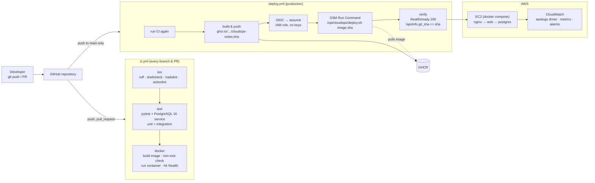

# Pipeline architecture

**GitHub → Build → Test → Docker → Deploy → Monitor**

## Workflow triggers

| Workflow | Trigger | Branch filter | Needs secrets? |
|---|---|---|---|
| `ci.yml` | `push` (any branch, ignoring `*.md` / screenshots), `pull_request` → main, manual, `workflow_call` | all | no |
| `deploy.yml` | `push` to **main** touching the app / Dockerfile / deploy files, or manual (`image_tag` for rollback) | main only | no secrets; 4 *variables* |

`concurrency` cancels superseded CI runs on the same branch but never cancels a running deploy.

## Stages

### Build / lint (`lint` job)
`ruff check` + `ruff format --check` on the app, `shellcheck -x` on every `*.sh` in the repo,
`hadolint` on every Dockerfile, `actionlint` on the workflows themselves. Fails fast, costs ~40 s.

### Test (`test` job)
`services: postgres:16-alpine` gives the job a real database on `localhost:5432` with a health
check, so `TEST_DATABASE_URL` is set and the integration tests (`test_integration_pg.py`) run, not
skip. The JUnit report is uploaded as an artifact.

### Docker (`docker` job)
`docker/build-push-action` with the GitHub Actions layer cache (`type=gha`) builds the module 04
Dockerfile, loads it locally, asserts `id -u == 10001` and that `/app/.env` does not exist, starts
the container with the in-memory store and calls `/health`, `/health/ready`, `POST /api/notes`.
Finally `docker compose config` validates the local compose file. The image is **not** pushed from
CI — only `main` publishes.

### Deploy (`deploy.yml`)
1. **ci** — reuses `ci.yml` (`workflow_call`) so a direct push to main still gets tested.
2. **build-push** — builds once more with the cache and pushes `ghcr.io/<owner>/cloudops-notes:<sha12>`
   and `:latest`. Auth = `GITHUB_TOKEN` with `packages: write`. For a manual rollback
   (`image_tag` input) the build is skipped and the given tag is deployed as-is.
3. **deploy** — `aws-actions/configure-aws-credentials` exchanges the job's OIDC token for 1-hour
   credentials of `cloudops-github-deploy` (trust policy pins `repo:<owner>/<repo>:ref:refs/heads/main`).
   `aws ssm send-command` runs `/opt/cloudops/deploy.sh <image> <sha>` on the instance — no SSH
   port, no key pair in GitHub. The job polls `get-command-invocation`, prints the instance output
   into the step summary, then curls `APP_URL/health/ready` and checks `git_sha` in `/api/info`
   equals the commit. The job uses the `production` environment, so required reviewers can be
   enforced and the deployment history shows in the repo sidebar.

### On the instance (`06-…/deploy/deploy.sh`)
Validates the image reference, `docker pull`, updates `IMAGE`/`GIT_SHA` in `/opt/cloudops/.env`,
`docker compose up -d` (only `web` is recreated), waits up to 90 s for `/health/ready`, and **rolls
back** to the previous image if it never becomes healthy. Everything is appended to
`/var/log/cloudops/deploy.log`.

## Secrets management

| Secret | Where it lives | How the pipeline uses it |
|---|---|---|
| AWS credentials | nowhere — OIDC federation | `id-token: write` + role ARN *variable* |
| Registry credentials | `GITHUB_TOKEN` (auto, scoped to the run) | `docker/login-action` |
| DB password, Flask `SECRET_KEY` | `/opt/cloudops/.env` on the instance (0600) or SSM Parameter Store | never passed through GitHub |
| `.env` files | git-ignored; CI copies `.env.example` only to validate compose | — |

Repository **variables** (not secrets, they are not sensitive): `AWS_REGION`, `AWS_ROLE_ARN`,
`EC2_INSTANCE_ID`, `APP_URL`. Without them the deploy job exits early with a notice — forks and
PRs do not fail.

## Failure recovery

| Failure | What you see | Recovery |
|---|---|---|
| lint/test fails | red check on the PR | fix and push; nothing was deployed |
| image build fails | `docker` job red | same; the previous image keeps running |
| SSM command `Failed` | instance stdout/stderr in the step summary | `deploy.sh` already rolled back; inspect `/var/log/cloudops/deploy.log` |
| health verification times out | `::error:: … did not become healthy` | `aws ssm start-session --target <id>` → `docker compose -f /opt/cloudops/docker-compose.yml logs web` |
| bad release found later | — | *Run workflow* → `image_tag` = previous sha (tags are listed under Packages) |
| instance replaced | `InvalidInstanceId` | bootstrap the new one with `ec2-docker-bootstrap.sh`, update `EC2_INSTANCE_ID` |
| role trust broken | `Not authorized to perform sts:AssumeRoleWithWebIdentity` | re-run `aws/github_oidc_setup.sh --repo owner/name` (checks the `sub` claim) |
