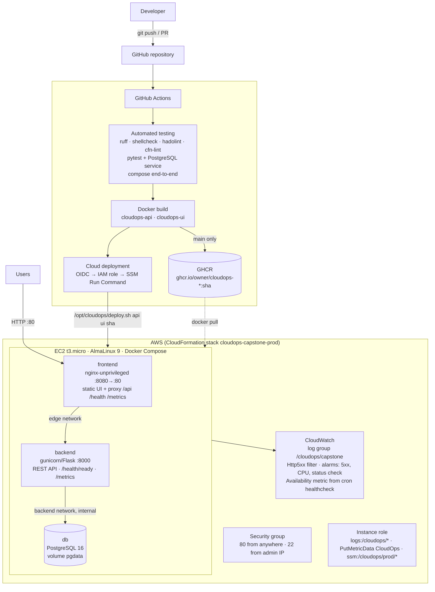

# CloudOps — architecture



## Components

| Layer | Implementation | Why |
|---|---|---|
| Frontend | static HTML/CSS/JS served by `nginxinc/nginx-unprivileged` | no build step, non-root, nginx also proxies the API so the browser talks to one origin (no CORS) |
| Backend | Flask 3 + gunicorn, package `cloudops_api` | evolved from the module 03 app: same config/logging code, tasks instead of notes, `/metrics`, `/api/stats`, deployment log |
| Database | PostgreSQL 16 container, named volume; schema in `database/init.sql` | cheapest option on one host; `DB_HOST`/`DB_SSLMODE` env vars switch it to RDS (module 03) with no code change |
| Config | environment variables, `.env` on the host (0600), optional SSM SecureString | twelve-factor; secrets never in images, git or GitHub |
| Containers | two Dockerfiles, `docker/docker-compose.yml` (dev, builds) and `docker-compose.prod.yml` (GHCR images, awslogs) | identical topology locally and in the cloud |
| Infrastructure | `infrastructure/cloudformation/cloudops-stack.yml` | declarative, idempotent, `delete-stack` removes everything; default VPC keeps cost at the instance only |
| CI/CD | `.github/workflows/ci.yml`, `deploy.yml` | tests + image build on every push; main → GHCR → OIDC → SSM → verify → rollback on failure |
| Monitoring | JSON logs → CloudWatch (awslogs driver), `Http5xx` metric filter, 3 alarms, `/metrics` Prometheus endpoint, cron synthetic check publishing `CloudOps/Availability` | symptom-based alerting (5xx, availability) plus cause metrics (CPU, status check) |

## Request path

```
browser ── :80 ─▶ frontend (nginx) ── /api/* ─▶ backend:8000 (gunicorn, 2 workers) ── 5432 ─▶ db
                     │ static files                 │ JSON log line per request → stdout → awslogs → CloudWatch
                     └ /nginx-health                └ /health (liveness) · /health/ready (DB) · /metrics
```

## Networks and trust boundaries

- `edge` (frontend ↔ backend) and `backend` (backend ↔ db, `internal: true`). Only the frontend
  publishes a port. The database is unreachable from the host network and the internet.
- Security group: 80 from `0.0.0.0/0`; 22 only from the `AdminCidr` parameter (defaults to
  blocked — Session Manager replaces SSH).
- IAM: the instance can write only `/cloudops/*` log groups, the `CloudOps` metric namespace and
  read `/cloudops/prod/*` parameters. GitHub's role can only `ssm:SendCommand` to instances tagged
  `Project=cloudops` with the shell-script document.
- Containers: non-root (uid 10001 / nginx 101), read-only root fs for the API, no-new-privileges,
  CPU/memory limits.

## Known limitations (deliberate, documented)

- Single instance, no load balancer or TLS: fine for a demo; the next step is an ALB + ACM
  certificate (or Caddy/certbot on the host) and a second instance or ECS.
- `/metrics` counters are per gunicorn worker (two workers → two series when scraped through the
  proxy). A Prometheus client with multiprocess mode or a sidecar would merge them.
- PostgreSQL on the same host means the data volume dies with the instance. Switch to RDS for
  anything real (`DB_HOST`, `DB_SSLMODE=require`), as module 03 shows.
